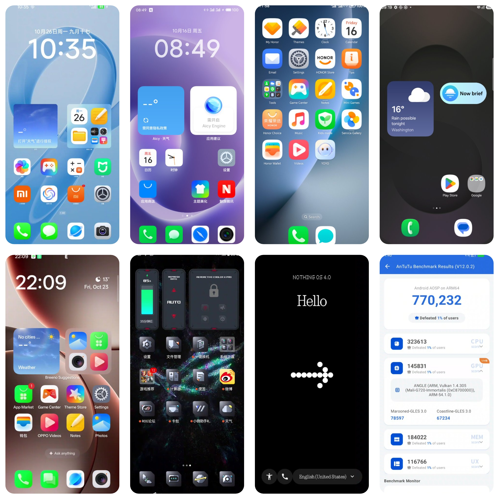

[English](docs/README.md) | 简体中文

<p align="center">
  <a href="https://www.opencecs.com">
    
  </a>
</p>

<h1 align="center">OPENCECS</h1>

<p align="center">
  <a href="https://www.opencecs.com"><b>www.opencecs.com</b></a>
  <a href="https://github.com/opencecs/tebox">GitHub</a>
</p>

<p align="center">
  <b>tebox — Android GSI 运行基座</b><br>
  跨平台 通用 GSI 镜像启动能力
</p>

<p align="center">
  <a href="https://github.com/opencecs/tebox/stargazers"></a>
  <a href="https://github.com/opencecs/tebox/network/members"></a>
  <a href="LICENSE"></a>
  <a href="https://www.opencecs.com"></a>
</p>

## 项目简介

**tebox** 是一套面向全平台的 **Android GSI 运行基座**：在 QEMU 上提供通用的 ARM64 GSI 镜像启动能力，并内置 gfxstream（ANGLE + Vulkan）与 VirGL（Mesa）两套图形加速及 **自主研发的 ARM Mali GPU 直通技术**，方便你直接上手验证、二次开发和自动化。

仓库：[github.com/opencecs/tebox](https://github.com/opencecs/tebox)  官网：[www.opencecs.com](https://www.opencecs.com)

> 说明：能否完整启动取决于目标 GSI 的 Treble / VINTF 要求；厂商专有分区与闭源服务需自行适配。基座提供的是可扩展的运行与 HAL 框架，而不是某一机型的一键刷机包。从设备提取或使用第三方 / 厂商镜像、固件与闭源组件时，请自行确认并遵守当地法律、厂商许可协议与版权要求；相关合规与法律风险由使用者自行承担。

## 启动截图

<p align="center">
  
</p>

### 相关资源

- 各类社区 GSI 镜像汇总下载：[Mystic GSI Updates（SourceForge）](https://sourceforge.net/projects/mystic-gsi-updates/files/)

## 运行环境

| 宿主 | 说明 |
| --- | --- |
| **macOS ARM64**（Apple Silicon，M1–M4） | 推荐；HVF + gfxstream / VirGL 已验证 |
| **Linux ARM64** | 支持原生构建与运行（KVM） |
| **Linux x86_64** | 主要用于交叉编译 Android ARM64 客体 |
| **Windows x86_64** | 原生 QEMU/VirGL PE 运行时 |

## 正确拉取源码

先安装并初始化 Git LFS（macOS：`brew install git-lfs`；Ubuntu/Debian：`sudo apt-get install git-lfs`）：

```bash
git lfs install
git clone https://github.com/opencecs/tebox.git
cd tebox
git lfs pull
```

## 快速开始

```bash
bash .ci/install-deps.sh
source build/envsetup.sh
lunch aosp_arm64-BP4A.251205.006
m
SNAPSHOT=1 ./run aosp_arm64-BP4A.251205.006
```

GSI 变体树在对应的 `GSI/...` 分支（AOSP 示例为 `GSI/AOSP/aosp_arm64-BP4A.251205.006`）。检出后替换 `src/aosp/<variant>/images/system.img` 即可尝试其他 GSI。

## AI 辅助开发

Agent / 自动化请先读本 README，再进入 [`.ai/README.md`](.ai/README.md) 自取技能、提示词与开发流程（工程约束见 `.ai/AGENTS.md`）。根目录不再放置各工具专用的说明文件。

## 许可证

本项目以 [Apache License 2.0](LICENSE) 开源。第三方源码与二进制仍遵循其各自许可证。

## Star History

<a href="https://www.star-history.com/#opencecs/tebox&Date">
 <picture>
   <source media="(prefers-color-scheme: dark)" srcset="https://api.star-history.com/svg?repos=opencecs/tebox&type=Date&theme=dark" />
   <source media="(prefers-color-scheme: light)" srcset="https://api.star-history.com/svg?repos=opencecs/tebox&type=Date" />
   
 </picture>
</a>

## 贡献者

感谢所有参与 tebox 的贡献者。

<a href="https://github.com/opencecs/tebox/graphs/contributors">
  
</a>

Made with [contrib.rocks](https://stg.contrib.rocks).

欢迎在 [GitHub](https://github.com/opencecs/tebox) 提交 Issue / PR。
