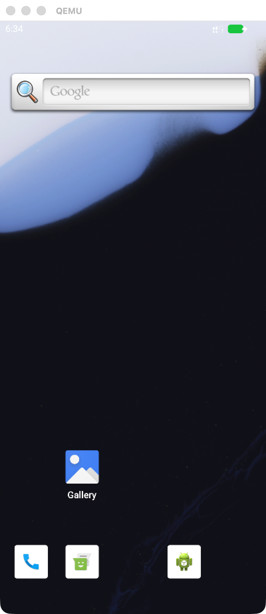
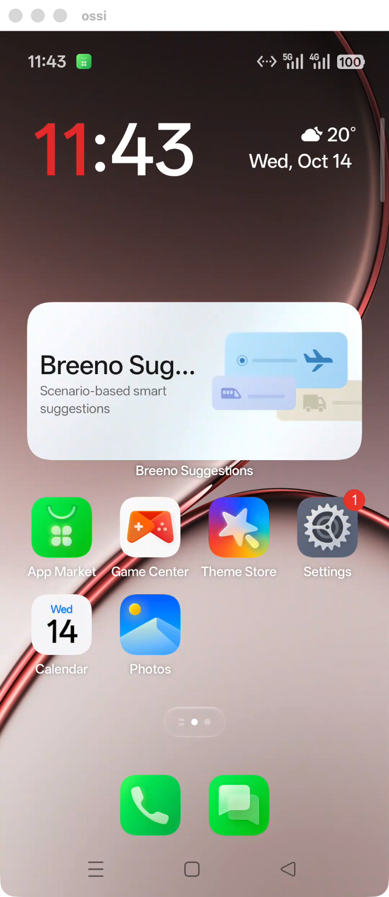
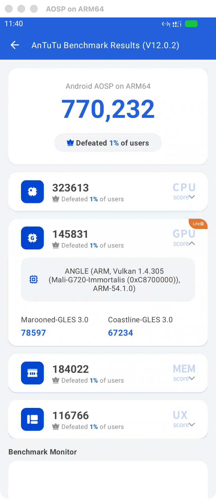
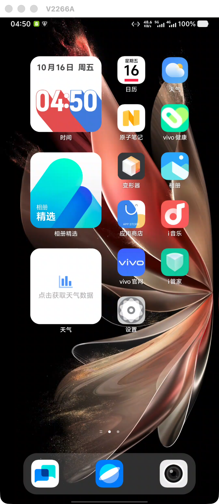
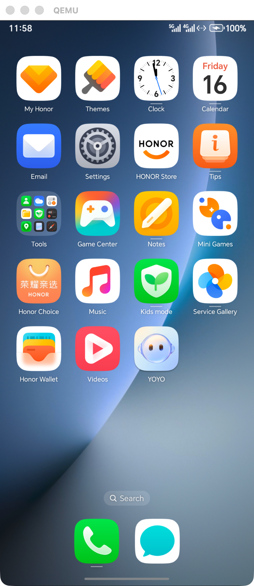
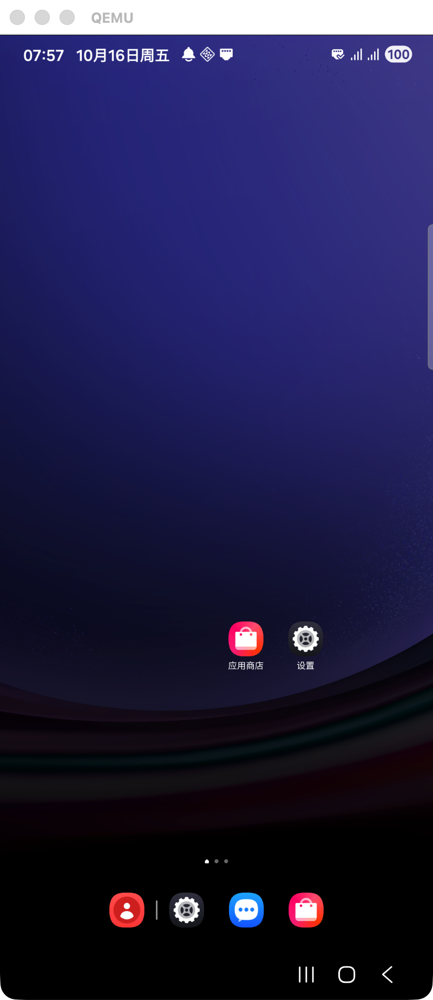
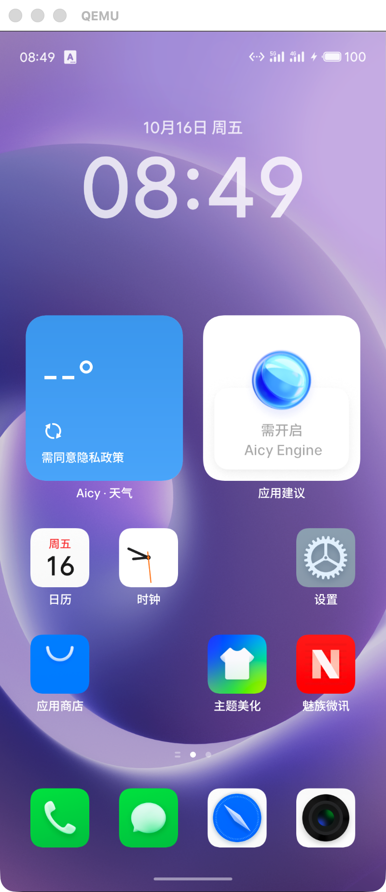

[English](docs/README.md) | 简体中文

<p align="center">
  <a href="https://www.opencecs.com">
    
  </a>
</p>

<h1 align="center">OPENCECS</h1>

<p align="center">
  <a href="https://www.opencecs.com"><b>www.opencecs.com</b></a>
  <a href="https://github.com/opencecs/tebox">GitHub</a>
</p>

<p align="center">
  <b>tebox — 桌面端 Android GSI 运行基座</b><br>
  通用 GSI 镜像启动能力  gfxstream / VirGL 图形加速  Soft Vendor HAL 示例
</p>

<p align="center">
  <a href="https://github.com/opencecs/tebox/stargazers"></a>
  <a href="https://github.com/opencecs/tebox/network/members"></a>
  <a href="LICENSE"></a>
  <a href="https://www.opencecs.com"></a>
</p>

## 项目简介

**tebox** 是一套面向桌面端的 **Android GSI 运行基座**：在 QEMU 上提供通用的 ARM64 GSI 镜像启动能力，并内置 gfxstream（ANGLE + Vulkan）与 VirGL（Mesa）两套图形加速、GKI 内核与 soft vendor HAL 示例，方便你直接上手验证、二次开发和自动化。

仓库：[github.com/opencecs/tebox](https://github.com/opencecs/tebox)  官网：[www.opencecs.com](https://www.opencecs.com)

### 基座能力

- **通用 GSI 运行**：以官方 aosp_arm64 GSI 为默认示例，也可替换为任意兼容的 ARM64 GSI（例如 Google、Samsung 等厂商发布的 GSI / Treble 镜像，或由 Pixel、Galaxy 等设备提取的 system 镜像）
- **图形与输入**：gfxstream（默认）与 VirGL 两种 GPU 加速可选，virtio 触摸屏
  - 每个镜像目录下的 `GPU` 文件（与 `KERNEL` 同级）写 `gfxstream` 或 `virgl` 即可切换；单次启动也可用 `FORCE_RUTABAGA=1/0` 覆盖
  - gfxstream：客体 GLES 经 ANGLE 转为 Vulkan，在宿主 GPU 上执行，显示 / 投屏 / 编码全程走 GPU（dma-buf 零拷贝）
  - 性能：相较原生运行，目前 GPU 约有 20% 的损耗；与 VirGL 相比，因 GL 转 Vulkan 约多 5% 的损耗
- **编解码**：Gallium video 直通到宿主后端（Linux VA-API / macOS VideoToolbox），Mesa 客体侧注册 `c2.mesa.*` 编解码组件（H.264 / H.265 / VP9 / AV1）
- **开机所需 HAL 示例**：已内置 Graphics、KeyMint（soft）、Health、Power、Audio 等 soft / stub 实现，可按厂商需求裁剪或替换

> 说明：能否完整启动取决于目标 GSI 的 Treble / VINTF 要求；厂商专有分区与闭源服务需自行适配。基座提供的是可扩展的运行与 HAL 框架，而不是某一机型的一键刷机包。从设备提取或使用第三方 / 厂商镜像、固件与闭源组件时，请自行确认并遵守当地法律、厂商许可协议与版权要求；相关合规与法律风险由使用者自行承担。

### 相关资源

- 各类社区 GSI 镜像汇总下载：[Mystic GSI Updates（SourceForge）](https://sourceforge.net/projects/mystic-gsi-updates/files/)

## 适用场景

- 在桌面环境验证 / 对比不同 GSI 镜像
- 开发与调试 vendor HAL、图形栈与系统服务
- 搭建 CI，对 GSI + HAL 改动做自动化编译与冒烟

## 运行环境

| 宿主 | 说明 |
| --- | --- |
| **macOS ARM64**（Apple Silicon，M1–M4） | 推荐；HVF + gfxstream / VirGL 已验证 |
| **Linux ARM64** | 支持原生构建与运行（KVM） |
| **Linux x86_64** | 主要用于交叉编译 Android ARM64 客体 |
| **Windows x86_64** | 原生 QEMU/VirGL PE 运行时 |

客体为 **aarch64 Android GSI**；推荐配备可用 GPU 与图形会话。

## 启动截图

<p align="center">
  
  
  
</p>

<p align="center">
  左：AOSP GSI　中：厂商 ROM 示例（ColorOS GSI）　右：安兔兔 V12 跑分（R1P / CIX 8180，gfxstream：ANGLE + Vulkan on Mali-G720）
</p>

<p align="center">
  
  
  
</p>

<p align="center">
  左：OriginOS GSI（vivo，Android 15）　中：MagicOS GSI（荣耀，Android 16）　右：OneUI GSI（三星 Galaxy Tab S9，Android 16）
</p>

<p align="center">
  
</p>

<p align="center">
  Flyme GSI（魅族 22，Android 15）
</p>

## 正确拉取源码

先安装并初始化 Git LFS（macOS：`brew install git-lfs`；Ubuntu/Debian：`sudo apt-get install git-lfs`）：

```bash
git lfs install
git clone https://github.com/opencecs/tebox.git
cd tebox
git lfs pull
```

## 快速开始

```bash
bash .ci/install-deps.sh
FORCE_VIRGL=1 SNAPSHOT=1 ./run
```

默认会启动仓库内置的 AOSP GSI 示例变体。替换 `src/aosp/<variant>/images/system.img` 即可尝试其他 GSI。

## 许可证

本项目以 [Apache License 2.0](LICENSE) 开源。第三方源码与二进制仍遵循其各自许可证。

## Star History

<a href="https://www.star-history.com/#opencecs/tebox&Date">
 <picture>
   <source media="(prefers-color-scheme: dark)" srcset="https://api.star-history.com/svg?repos=opencecs/tebox&type=Date&theme=dark" />
   <source media="(prefers-color-scheme: light)" srcset="https://api.star-history.com/svg?repos=opencecs/tebox&type=Date" />
   
 </picture>
</a>

## 贡献者

感谢所有参与 tebox 的贡献者。

<a href="https://github.com/opencecs/tebox/graphs/contributors">
  
</a>

Made with [contrib.rocks](https://stg.contrib.rocks).

欢迎在 [GitHub](https://github.com/opencecs/tebox) 提交 Issue / PR。
